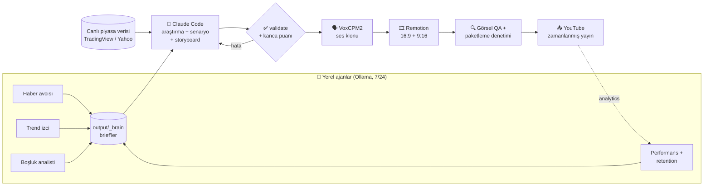

<div align="center">

# 🎬 YouTube Finans Otomasyon Hattı

**Her gün kendi kendine araştıran, yazan, seslendiren, hareketli grafiklerle kurgulayan ve YouTube'a yükleyen yerel bir video fabrikası.**


</div>

> **EN —** A fully local, daily YouTube production line for a Turkish finance channel. Claude Code researches the day's
> markets and writes a scene-by-scene script, VoxCPM2 voices it with a cloned voice, 40+ Remotion templates turn it into
> motion graphics (16:9 + 9:16 Shorts), and the YouTube Data API schedules the upload. Local Ollama agents watch news,
> trends, retention and comments around the clock and feed what they learn back into the next script.

---

## 💡 Neden?

Tek kişilik bir finans kanalında her gün video çıkarmak; haber taramak, rakam doğrulamak, metin yazmak, seslendirmek,
grafik hazırlamak, kurgu, kapak, başlık ve yükleme demek. Bu proje bu işlerin **tamamını tek bir zamanlanmış koşuya**
indirir ve daha önemlisi **kanalın kendi verisinden öğrenir**: hangi konu izlendi, izleyici nerede videodan çıktı,
hangi kapak tıklandı. Ertesi günün senaryosu bunlara göre yazılır.

## 🧭 Mimari



## ✨ Öne çıkanlar

| | |
|---|---|
| 🧠 **Araştırma + senaryo** | Claude Code (`claude -p`, headless) günün haberlerini ve piyasa verisini toplar, her rakamı iki kaynakla doğrular, sahne sahne senaryo + storyboard yazar |
| 🔁 **Kendini düzelten hat** | `validate.py` hata bulursa aynı Claude oturumuna düzeltme turu açılır; kullanım limitine takılırsa sıfırlanmayı bekleyip **aynı oturumdan** devam eder |
| 🪝 **Kanca puanlama** | Açılış için 5 kanca yazılır; somutluk / hitap / risk / merak / kısalık üzerinden puanlanır (`tools/hookscore_tr.py`) |
| 🗣️ **Tutarlı ses** | VoxCPM2 ile paragraf bazlı ses klonu, sabit tohum ve **ses kapısı**: perde 1,5 yarıtondan fazla saparsa segment yeniden üretilir. Türkçe sayı okuma kuralları (`tr_number_speech.py`) |
| 🎞️ **Motion graphics** | 40+ Remotion sahnesi: mum grafikleri, ısı haritası, dünya haritası, getiri eğrisi, 3D metal/küre/nesne, şelale, domino zinciri, nesne tutan 3D sunucu… Sahneler seslendirmedeki **kelimeye kilitlenir** |
| 🔍 **Çok katmanlı denetim** | Metin doğrulayıcı, Türkçe başlık/kanca linter'ı, render öncesi kare kare görsel QA, yükleme öncesi başlık/kapak paketleme denetimi |
| ⚖️ **Politika katmanı** | Hassas konu tonu, her açıklamaya sorumluluk reddi, YouTube AI içerik beyanı (`contains_synthetic_media`), şablon tekrarı koruması |
| 📱 **Shorts** | Aynı gün 2 dikey Shorts; bilgiyi tamamlamaz, uzun videoya köprü kurar |
| 📤 **Yayın** | Private yükleme + `publishAt` zamanlama, oynatma listesi, 3 kapak (A/B/C) |
| 📊 **Panel** | `tools/dashboard/` — koşu durumu, loglar, ajan çıktıları (`localhost:8765`) |

## 🗓️ Günlük akış (varsayılan)

| Saat | Ne olur |
|---|---|
| 11:00 | Görev Zamanlayıcı `tools/daily_run.py --auto` başlatır (PC uykudaysa uyandırır, koşu bitene kadar uyutmaz) |
| ~11:20 | Senaryo hazır → doğrulama → ses → görsel QA → render |
| 15:00 | 1. Shorts yayında |
| 18:00 | Uzun video yayında (Pzt/Çar/Cum; diğer günler yalnız Shorts) |
| 21:00 | 2. Shorts yayında |

Başlangıç saati `scripts/setup_daily_auto.ps1` içinde, yayın saatleri `config.yaml → youtube.auto_publish` altında.
Belirli bir güne konu sabitlemek için `output/_daily/topic_YYYY-MM-DD.txt` dosyasına konuyu yazman yeterli.

## 🤖 Ajanlar

Ağır işler sürerken (render, TTS) LLM'li ajanlar kendini bekletir; GPU'yu üretimle paylaşmazlar.

| Ajan | Sıklık | Görevi |
|---|---|---|
| `news_hunter` | saatte bir | Bloomberg HT + Google News → puanlı başlıklar ve günün 3 video açısı |
| `trend_scout` | 3 saatte bir | TR + global ekonomi videolarında patlayan başlık/format kalıpları |
| `perf_watch` | günde 2 | Data + Analytics API → konu başına izlenme, izlenme oranı, abone/1k |
| `gap_analyst` | 4 saatte bir | Bizde hiç olmayan ve aşırı tekrarlanan konular (sayım koddan, yorum modelden) |
| `night_editor` | 4 saatte bir | Günün üretimine editör notu + yarın için açı fikirleri |
| `brain` | 45 dk'da bir | Kendi araştırma sorgularını seçen, fikir havuzu üreten yerel "beyin" |
| `qa_auditor` | 30 dk'da bir | Diğer ajanların çıktısını denetler: bayat mı, uydurma izi var mı |
| `sys_watch` | 10 dk'da bir | Disk alanı, takılı kilit, hata dosyaları, Ollama/RAM, sessiz kalan ajanlar, OAuth token süresi |
| `comment_agent` | 2 saatte bir | Yorumlara kanal üslubunda cevap; emin olunamayanlar onay kuyruğuna |

Yerel model çıktıları senaryoya yalnız **ipucu** olarak girer: Claude her rakamı ve iddiayı kendi kaynağından yeniden doğrular.

## 📈 Sahada öğrenilenler

Bu kurallar gerçek kanal verisinden çıktı ve `prompts/daily_video.md` + `validate.py` içinde kodlandı:

- **Keşfedilebilirlik her şeyden önemli.** Küçük kanalda uzun video izlenmesinin büyük kısmı abone akışından gelir.
  "Haftanın özeti" yerine kanalı tanımayan birinin arayacağı, haftalarca geçerli tarihsel/hesaplı sorular daha çok izlenir.
- **İlk 30 saniye.** Selamlama ve kendini tanıtma yok; ilk cümlede doğrulanmış bir rakam, sonra merak boşluğu.
- **Bir cümlede en fazla 2 rakam.** Fazlası ekrana; seslendirmede rakam yığını izleyiciyi kaçırıyor.
- **Shorts izlenme getirir, abone getirmez.** Günde 4 yükleme abone akışını yoruyor; Shorts'un işi uzun videoya köprü.
- **Şablon tekrarı yasak.** Aynı başlık kalıbı art arda kullanılmaz; her video o güne özgü bir hesap içerir
  (YouTube'un tekrarlayan içerik politikası).
- **Arama kutusu gerçek veridir.** YouTube otomatik tamamlama sorguları (`yt_suggest.py`) başlığın ilk 45 karakterine girer.

## 🖥️ Gereksinimler

- **Windows 10/11**, NVIDIA GPU (16 GB VRAM ile test edildi; RTX 50 serisi için CUDA 12.8)
- **Python 3.12**, **Node.js 20+**, **ffmpeg** (PATH'te)
- **[Claude Code](https://claude.com/claude-code)** CLI (senaryo üretimi için, `claude` komutu PATH'te)
- **[Ollama](https://ollama.com)** (yerel ajanlar için, ör. `qwen3:14b`) — opsiyonel
- Google Cloud projesi: **YouTube Data API v3**, **YouTube Analytics API**, (opsiyonel) **Drive API**

## 🚀 Kurulum

```powershell
git clone https://github.com/SerhatUygun/youtube-finans-otomasyon.git
cd youtube-finans-otomasyon

# 1) Python ortamı + PyTorch (cu128) + bağımlılıklar
powershell -ExecutionPolicy Bypass -File scripts\setup_env.ps1

# 2) Seslendirme motoru (VoxCPM2)
powershell -ExecutionPolicy Bypass -File scripts\setup_voxcpm.ps1

# 3) Remotion
cd remotion; npm install; cd ..

# 4) Ses efektlerini üret (telifsiz, sentetik)
.venv\Scripts\python.exe scripts\gen_sfx.py
```

### Yapılandırma

1. `.env.example` → `.env` olarak kopyala, gerekli anahtarları doldur.
2. **Ses referansı:** `assets/voice_reference/prompt_clean.wav` — kendi sesinden 10–30 sn temiz kayıt.
   Yalnızca **sana ait ya da kullanım izni olan** bir sesi klonla.
3. **Kanal kişiliği:** `channel_persona.json` — niş, ton, hedef kitle, kanca tarzı.
4. **Marka:** `remotion/public/brand/emblem_white.png` (yer tutucu var, kendi logonla değiştir) ve
   `remotion/src/core/brand.tsx` içindeki kanal adı.
5. **Opsiyonel:** `seslendir.txt` (kendi yazdığın üslup örneği, senaryo tonunu belirler) ve
   `config.yaml → ref_watch.channel` (ilham alınacak referans kanal; yalnız konu/yapı, kopya değil).
6. **YouTube:** Google Cloud Console → OAuth Client ID (Desktop app) → JSON'u
   `secrets/youtube_client_secret.json` olarak kaydet, sonra:
   ```powershell
   .venv\Scripts\python.exe tools\reauth_google.py
   ```
   > ⚠️ OAuth uygulaması **Testing** modundaysa Google yetkileri **7 günde bir** düşer.
   > Kalıcı çalışma için uygulamayı **In production**'a al.

### Çalıştırma

```powershell
# Bugünün videosu (yüklemeden, sadece üret)
.venv\Scripts\python.exe -X utf8 tools\daily_run.py --no-upload

# Konuyu sabitle
.venv\Scripts\python.exe -X utf8 tools\daily_run.py --topic "Fed faiz kararı öncesi altın"

# Yalnız Shorts / zorla uzun video
.venv\Scripts\python.exe -X utf8 tools\daily_run.py --shorts-only
.venv\Scripts\python.exe -X utf8 tools\daily_run.py --long

# Her gün otomatik çalışsın (Görev Zamanlayıcı, uyandırma açık)
powershell -ExecutionPolicy Bypass -File scripts\setup_daily_auto.ps1
```

Çıktılar `output/daily-YYYYMMDD/` altına, günlük rapor `output/_daily/YYYY-MM-DD.md` dosyasına yazılır.

## 🪝 Kanca puanlayıcı

```powershell
.venv\Scripts\python.exe -X utf8 tools\hookscore_tr.py --hook "Faiz inince gram altın uçar, değil mi?"
.venv\Scripts\python.exe -X utf8 tools\hookscore_tr.py --daily output\daily-20261021
```

Karar = %60 ortalama + %40 en zayıf özellik: tek bir zayıf yan kancayı sızdırır.
[chatgpt-youtube-agent-skill](https://github.com/Jakeschincariol/chatgpt-youtube-agent-skill)'deki `hookscore.py`'den Türkçeye uyarlandı
(orijinal `[a-z]` regex'i Türkçe harfleri atıyordu).

## 📁 Proje yapısı

```
pipeline/
  daily/          günlük hat: build (ses→render→yükleme), validate, timeline, qa, packaging_audit, lint_tr
  stages/         eski aşamalı hat (s01 script … s10 drive) — yükleme/Drive yardımcıları buradan
  policy.py       hassas konu tonu + sorumluluk reddi + AI beyanı
  tv_data.py      fiyat verisi (TradingView spot, Yahoo yedek)
prompts/          Claude'a giden talimatlar (daily_video.md = ana senaryo talimatı, scene_catalog.md = sahne kataloğu)
remotion/src/
  auto/           günlük video kompozisyonları ve şablon kütüphanesi (templates*.tsx, Presenter3D)
  core/           tema, marka, ortak bileşenler
tools/
  daily_run.py    günlük koşunun giriş noktası
  hookscore_tr.py Türkçe kanca puanlayıcı
  agents/         yerel ajanlar (haber, trend, performans, boşluk, gece editörü, denetçi, sistem)
  dashboard/      kontrol paneli
scripts/          kurulum ve model indirme betikleri
config.yaml       tüm ayarlar (yorumlu)
```

> ℹ️ **Bu repoda olmayanlar:** kanala özel müzik üreteci (`scripts/fed_motion/`) ve stil dokümanları (`docs/`) çıkarıldı.
> Müzik üreteci yoksa hat sessiz bir müzik yatağıyla render eder; `make_music.py <saniye> <çıktı.wav> <tohum> <ruh_hali>`
> imzasıyla kendi betiğini `scripts/fed_motion/` altına koyabilirsin. `scripts/` altındaki Wan, EchoMimic, LatentSync gibi
> betikler önceki deneylerden kaldı; günlük hat bunlara ihtiyaç duymaz.

## ⚖️ Sorumlu kullanım

- Videolar **yatırım tavsiyesi değildir**; hat her açıklamaya sorumluluk reddi ekler, senaryoda al/sat/hedef fiyat yasaktır.
- YouTube politikası gereği sentetik içerik **AI beyanı** ile yüklenir (`contains_synthetic_media`).
- Ses klonlamayı yalnızca kendi sesin ya da izinli bir ses için kullan.
- Başka kanalların içeriğini kopyalamak/çevirmek için tasarlanmadı; referans izleyici yalnız konu/yapı notu çıkarır.

## 🤝 Katkı

Hata bildirimi ve öneriler için issue açabilirsin. Promptlar Türkçe finans için yazıldı ama `channel_persona.json`
ve `prompts/` değiştirilerek her nişe uyarlanabilir; uyarlamanı paylaşırsan sevinirim.

İletişim: [support@zelivra.space](mailto:support@zelivra.space)

## 📄 Lisans

MIT — bkz. [LICENSE](LICENSE). Kullanılan modellerin (VoxCPM2, SDXL, Whisper vb.) kendi lisansları geçerlidir.
