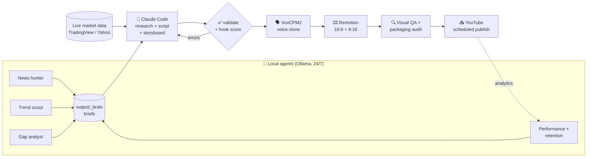

<div align="center">

# 🎬 YouTube Finance Automation Pipeline

**A local video factory that researches, writes, voices, edits with motion graphics and uploads to YouTube, every day, on its own.**


</div>

Built for a Turkish-language finance channel (gold, silver, the Fed, the Turkish lira, equities). The prompts and on-screen
content are in Turkish, but the pipeline is language-agnostic: swap the prompts and the persona to fit any niche.

---

## 💡 Why?

Publishing a video every day on a one-person finance channel means scanning the news, verifying numbers, writing,
voicing, building charts, editing, designing thumbnails, writing titles and uploading. This project collapses **all of it
into a single scheduled run**. More importantly, it **learns from the channel's own data**: which topics got watched,
where viewers dropped off, which thumbnails got clicked. The next day's script is written with that in mind.

## 🧭 Architecture



## ✨ Highlights

| | |
|---|---|
| 🧠 **Research + script** | Claude Code (`claude -p`, headless) gathers the day's news and market data, verifies every number against two sources, and writes a scene-by-scene script and storyboard |
| 🔁 **Self-correcting** | If `validate.py` finds errors, a fix round is opened in the same Claude session. If a usage limit is hit, it waits for the reset and **resumes the same session** |
| 🪝 **Hook scoring** | Five opening hooks are written and scored on concreteness, direct address, stakes, curiosity and brevity (`tools/hookscore_tr.py`) |
| 🗣️ **Consistent voice** | Paragraph-level voice cloning with VoxCPM2, a fixed seed, and a **voice gate**: any segment whose pitch drifts more than 1.5 semitones is regenerated. Turkish number-reading rules (`tr_number_speech.py`) |
| 🎞️ **Motion graphics** | 40+ Remotion scenes: candlestick charts, heatmaps, world maps, yield curves, 3D metals/globes/objects, waterfalls, domino chains, a 3D presenter holding objects… Every scene is **locked to the spoken word** that triggers it |
| 🔍 **Layered QA** | Script validator, Turkish title/hook linter, frame-by-frame visual QA before rendering, title/thumbnail packaging audit before upload |
| ⚖️ **Policy layer** | Sensitive-topic tone, a disclaimer in every description, YouTube's AI content disclosure (`contains_synthetic_media`), protection against repetitive templated content |
| 📱 **Shorts** | Two vertical Shorts per day that don't give the whole answer and point viewers to the long video |
| 📤 **Publishing** | Private upload + `publishAt` scheduling, playlists, three thumbnail variants (A/B/C) |
| 📊 **Dashboard** | `tools/dashboard/`: run status, logs and agent outputs (`localhost:8765`) |

## 🗓️ Daily schedule (default)

| Time | What happens |
|---|---|
| 11:00 | Task Scheduler starts `tools/daily_run.py --auto` (wakes the PC if asleep and keeps it awake until the run finishes) |
| ~11:20 | Script ready → validation → voice → visual QA → render |
| 15:00 | Short #1 goes live |
| 18:00 | Long video goes live (Mon/Wed/Fri; Shorts only on other days) |
| 21:00 | Short #2 goes live |

The start time lives in `scripts/setup_daily_auto.ps1`; publish times are under `config.yaml → youtube.auto_publish`.
To pin a topic to a specific day, write it into `output/_daily/topic_YYYY-MM-DD.txt`.

## 🤖 Agents

While heavy jobs are running (render, TTS), the LLM agents pause themselves so they never compete with production for the GPU.

| Agent | Frequency | What it does |
|---|---|---|
| `news_hunter` | hourly | Bloomberg HT + Google News → scored headlines and three video angles for the day |
| `trend_scout` | every 3 h | Title and format patterns that are taking off in Turkish and global economy videos |
| `perf_watch` | twice a day | Data + Analytics API → views, average view percentage and subscribers per 1k views, by topic |
| `gap_analyst` | every 4 h | Topics we've never covered vs. topics we're overusing (counts from code, commentary from the model) |
| `night_editor` | every 4 h | An editor's note on the day's output plus angle ideas for tomorrow |
| `brain` | every 45 min | A local "brain" that picks its own research queries and builds an idea pool |
| `qa_auditor` | every 30 min | Audits the other agents' output: is it stale, does it show signs of hallucination? |
| `sys_watch` | every 10 min | Disk space, stuck locks, error files, Ollama/RAM, silent agents, OAuth token expiry |
| `comment_agent` | every 2 h | Replies to comments in the channel's voice; anything uncertain goes to an approval queue |

Local model output only enters the script as a **hint**: Claude re-verifies every number and claim against its own sources.

## 📈 Lessons from the field

These rules came from real channel data and are encoded in `prompts/daily_video.md` and `validate.py`:

- **Discoverability beats everything.** On a small channel, most long-form views come from the subscription feed.
  Evergreen, historical or calculation-driven questions that a stranger would search for outperform "weekly recap" videos.
- **The first 30 seconds.** No greetings, no self-introduction. Open with a verified number, then a curiosity gap.
- **At most two numbers per sentence.** The rest go on screen; stacking numbers in the voiceover makes viewers leave.
- **Shorts bring views, not subscribers.** Four uploads a day wear out the subscription feed; a Short's job is to bridge to the long video.
- **No template repetition.** The same title pattern is never used back to back, and every video contains a calculation
  unique to that day (YouTube's repetitive-content policy).
- **The search box is real data.** YouTube autocomplete queries (`yt_suggest.py`) go into the first 45 characters of the title.

## 🖥️ Requirements

- **Windows 10/11**, NVIDIA GPU (tested with 16 GB VRAM; RTX 50 series needs CUDA 12.8)
- **Python 3.12**, **Node.js 20+**, **ffmpeg** (on PATH)
- **[Claude Code](https://claude.com/claude-code)** CLI for script generation (`claude` on PATH)
- **[Ollama](https://ollama.com)** for the local agents (e.g. `qwen3:14b`), optional
- A Google Cloud project with **YouTube Data API v3**, **YouTube Analytics API** and (optionally) **Drive API**

## 🚀 Installation

```powershell
git clone https://github.com/SerhatUygun/youtube-finans-otomasyon.git
cd youtube-finans-otomasyon

# 1) Python environment + PyTorch (cu128) + dependencies
powershell -ExecutionPolicy Bypass -File scripts\setup_env.ps1

# 2) Voice engine (VoxCPM2)
powershell -ExecutionPolicy Bypass -File scripts\setup_voxcpm.ps1

# 3) Remotion
cd remotion; npm install; cd ..

# 4) Generate sound effects (royalty-free, synthetic)
.venv\Scripts\python.exe scripts\gen_sfx.py
```

### Configuration

1. Copy `.env.example` to `.env` and fill in the keys you need.
2. **Voice reference:** `assets/voice_reference/prompt_clean.wav`, a clean 10–30 second recording of your own voice.
   Only clone a voice that **is yours or that you have permission to use**.
3. **Channel persona:** `channel_persona.json` sets the niche, tone, target audience and hook style.
4. **Branding:** `remotion/public/brand/emblem_white.png` (a placeholder is included; replace it with your logo) and
   the channel name in `remotion/src/core/brand.tsx`.
5. **Optional:** `seslendir.txt` (a style sample you wrote yourself; it sets the tone of the script) and
   `config.yaml → ref_watch.channel` (a reference channel for inspiration on topics and structure only, never copying).
6. **YouTube:** Google Cloud Console → OAuth Client ID (Desktop app) → save the JSON as
   `secrets/youtube_client_secret.json`, then run:
   ```powershell
   .venv\Scripts\python.exe tools\reauth_google.py
   ```
   > ⚠️ If your OAuth app is in **Testing** mode, Google revokes the grant **every 7 days**.
   > Move the app to **In production** for unattended operation.

### Running

```powershell
# Today's video (generate only, no upload)
.venv\Scripts\python.exe -X utf8 tools\daily_run.py --no-upload

# Pin the topic
.venv\Scripts\python.exe -X utf8 tools\daily_run.py --topic "Gold ahead of the Fed rate decision"

# Shorts only / force a long video
.venv\Scripts\python.exe -X utf8 tools\daily_run.py --shorts-only
.venv\Scripts\python.exe -X utf8 tools\daily_run.py --long

# Run automatically every day (Task Scheduler, wake enabled)
powershell -ExecutionPolicy Bypass -File scripts\setup_daily_auto.ps1
```

Output goes to `output/daily-YYYYMMDD/` and the daily report to `output/_daily/YYYY-MM-DD.md`.

## 🪝 Hook scorer

```powershell
.venv\Scripts\python.exe -X utf8 tools\hookscore_tr.py --hook "Faiz inince gram altın uçar, değil mi?"
.venv\Scripts\python.exe -X utf8 tools\hookscore_tr.py --daily output\daily-20261021
```

Verdict = 60% average + 40% weakest feature, so a single weak dimension drags the hook down.
Adapted to Turkish from `hookscore.py` in [chatgpt-youtube-agent-skill](https://github.com/Jakeschincariol/chatgpt-youtube-agent-skill)
(the original `[a-z]` regex dropped Turkish characters).

## 📁 Project structure

```
pipeline/
  daily/          daily pipeline: build (voice→render→upload), validate, timeline, qa, packaging_audit, lint_tr
  stages/         older staged pipeline (s01 script … s10 drive); upload/Drive helpers live here
  policy.py       sensitive-topic tone + disclaimers + AI disclosure
  tv_data.py      price data (TradingView spot, Yahoo fallback)
prompts/          instructions sent to Claude (daily_video.md = main script brief, scene_catalog.md = scene catalog)
remotion/src/
  auto/           daily video compositions and template library (templates*.tsx, Presenter3D)
  core/           theme, branding, shared components
tools/
  daily_run.py    entry point for the daily run
  hookscore_tr.py Turkish hook scorer
  agents/         local agents (news, trends, performance, gaps, night editor, auditor, system)
  dashboard/      control panel
scripts/          setup and model download scripts
config.yaml       all settings (commented)
```

> ℹ️ **Not included in this repo:** the channel-specific music generator (`scripts/fed_motion/`) and style documents
> (`docs/`) were removed. Without the music generator the pipeline renders with a silent music bed; you can drop your own
> script into `scripts/fed_motion/` with the signature `make_music.py <seconds> <output.wav> <seed> <mood>`.
> Scripts under `scripts/` for Wan, EchoMimic, LatentSync and similar are left over from earlier experiments; the daily
> pipeline doesn't need them.

## ⚖️ Responsible use

- The videos are **not investment advice**. The pipeline adds a disclaimer to every description, and buy/sell calls or
  price targets are banned in the script.
- Per YouTube policy, synthetic content is uploaded with an **AI disclosure** (`contains_synthetic_media`).
- Only clone your own voice or a voice you have permission to use.
- It is not designed to copy or translate other channels' content; the reference watcher only extracts notes on topic and structure.

## 🤝 Contributing

Issues and suggestions are welcome. The prompts were written for Turkish finance content, but you can adapt the pipeline
to any niche by editing `channel_persona.json` and `prompts/`. If you do, I'd love to see it.

Contact: [support@zelivra.space](mailto:support@zelivra.space)

## 📄 License

MIT. See [LICENSE](LICENSE). The models used (VoxCPM2, SDXL, Whisper, etc.) are subject to their own licenses.
